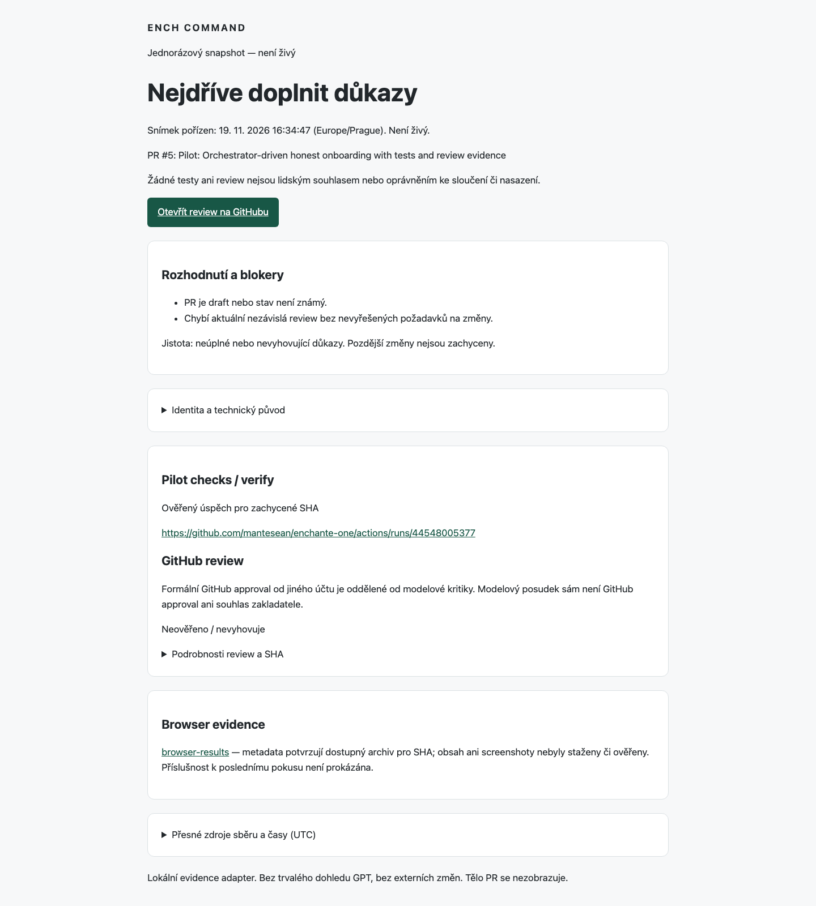
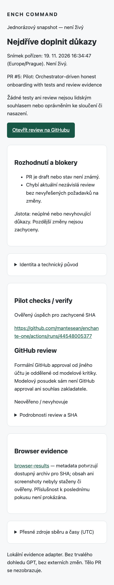

# ENCH COMMAND execution evidence — 2026-11-19

## Delivered and scope

A read-only evidence adapter and founder view for real `mantesean/enchante-one` PRs, stacked on PR #5. The command collects bounded GET responses through existing `gh`, writes timestamped JSON/HTML without overwriting old snapshots, and returns 0 for metadata ready to inspect, 2 for blocked evidence or 1 for collection failure. It has no model gateway, task queue, approval mutation, merge endpoint or deployment action. The customer application is unchanged.

The prior PR #3 state machine was inspected directly: `actor='founder'` is forgeable, evidence is a nonempty string and writes are not concurrency-safe. It is not imported or expanded. Issues #2/#4 and existing pilot PR #5 were inspected before work. Subsequent audit issues #10–#13 remain open; this change does not claim to resolve production enforcement, unattended integration, host isolation/recovery or full founder product acceptance.

## Correlated execution

- Base PR #5: `224edd9630405dd56e3953899000e46f4e3b1511`.
- Existing external runtime: Orchestrator.inc 0.15.3, session `enchante-one-2`, Codex harness, branch `feat/ench-command-evidence`, isolated worktree.
- Initial bounded assignment: 2026-11-19 15:19:16 UTC. Worker completed the correction turn by 15:31:23 UTC.
- Initial implementation: `27da6521c4d4ac906a2e9c57ca973658fbda3d3d`.
- Final executable revision: `cee451dff255f586bc6adf361e51f939b467cf1f`.
- Supervisor integration branch: `feat/ench-command-reviewed`, created directly from final executable revision. Subsequent additions are review records and screenshots; executable diff against `cee451d` is empty.
- Six supervisor follow-up messages after the initial assignment: provenance/race rules; protocol/audit handoff; founder progressive disclosure; exit-status correction; independent PR/base association finding; Claude review fixes. Supervisor also ran independent checks, performed live collection and handles draft publication. This is supervised execution, not zero-intervention autonomy.
- One user action was requested and completed: sign in to already-installed Claude Code with the existing subscription. No credentials were copied or printed in published evidence.

## Verified checks

Worker: `npm ci`, lint, typecheck, **52 existing tests + 58 command unit/CLI tests**, production build and **6 Playwright browser scenarios** passed. Browser scenarios include original onboarding plus COMMAND report/failure fixtures on desktop and mobile. Fixtures are explicitly marked TEST and never used as live fallback. Existing CI invokes `npm test`, so it includes the new tests without a second workflow or additional dependencies.

Supervisor independently ran the 58 command tests from the clean integration checkout: all passed. End-to-end CLI tests exercise deterministic exit codes and exclusive output creation. Existing checks are preserved; CI keeps read-only permissions and pinned actions. Remote CI is a separate required observation at the published PR, not inferred from local checks.

Final executable collector was run against real PR #5 at 15:34:47 UTC. Collection failures: none; recorded head `224edd9630405dd56e3953899000e46f4e3b1511`; expected exit **2** because the PR remains draft and has no current authorized non-author GitHub approval. The report recognizes its actual CI success and archive metadata without pretending either authorizes merge.

Actual snapshot was rendered in Chromium at 1440px desktop and 390px mobile: no horizontal overflow or page errors. Both screenshots were visually inspected. Technical provenance is expandable; links remain accessible. This is Chromium emulation, not a full device/accessibility audit.

## Independent reviews and corrections

A separate Codex context found missing PR/base association; the worker fixed it with regression tests. Final initial review of `27da652`: no remaining blocking finding, 36 command tests passed at that stage. That review is independent context, not a different model.

Actual Claude Code ran using the user's existing claude.ai Pro authentication, restricted read-only tools and no MCP connections. Runtime identified `claude-opus-5-5`. Its initial review found unauthorized outsider approvals and newer unassociated CI runs falling back to older successful runs. Both were fixed in `cee451d`, with negative and happy-path regression coverage. [Initial findings and disposition](CLAUDE-REVIEW-INITIAL-2026-11-19.md) are retained.

[Claude re-review](CLAUDE-REVIEW-FINAL-2026-11-19.md): no blocking findings in the reviewed contents. Restricted file access correctly prevented it from reading Git metadata outside the worktree; supervisor separately verified the exact clean revision and unchanged executable files. The model report is not a GitHub approval or founder authorization.

## Operational boundaries and costs

Orchestrator health and stored sessions were observed across multiple client calls; a daemon restart/crash, sleep recovery, remote host and 24/7 supervision were NOT tested. Worktrees isolate file changes, not host credentials/network/tenants. Claude's attempted out-of-scope metadata read was denied, which proves that specific read boundary only. Docker was unavailable; no isolation guarantee is inferred.

Authenticated GitHub read showed no main branch protection (404 Branch not protected) and empty rulesets. Drafts and read-only reporting do not stop a credential holder from direct push/merge. No merge/deploy or security-policy mutation was performed by this task. See the [operating protocol](OPERATING-PROTOCOL-2026-11-19.md).

No new subscription, credit purchase, paid API key or hosting was used. Subscription quota consumption, dollar-equivalent cost and human attention time were not independently metered and remain unknown. Worker context utilization is not total billed usage. Local failures included an unavailable shell PATH for Node (resolved by using the already-installed absolute executable); no global configuration was changed. A successful blocked-report exit 2 is intentional, not a hidden failure.

## Grok challenge and authentication correction

An actual [Grok architecture challenge](GROK-REVIEW-2026-11-19.md) completed in the existing authenticated Chrome session. The earlier signed-out in-app browser is a separate session. Grok highlighted enforcement, isolation/recovery and missing persistent-operation proof; those remain release blockers. This is supervised browser-based review, not a Grok CLI adapter. The protocol statement about missing Grok CLI remains correct.

## Verified protection update — 2026-11-19 15:37:26 UTC

The coordinated independent audit task configured protection on main. This supervisor separately re-fetched the authenticated GitHub protection endpoint successfully: required check `verify` pinned to GitHub Actions app 15368, strict/up-to-date checks, enforce_admins=true, one approving review, dismiss_stale_reviews=true, require_last_push_approval=true, required_conversation_resolution=true, force pushes=false and deletions=false. Earlier absence/404 observations and model statements are historical, preceding this change; they are preserved rather than overwritten. This task performed the confirming read, not the configuration change. A rejected unauthorized merge/push experiment and a production environment approval gate are not established by the GET response; issue #10 remains open. No merge or deployment occurred.
