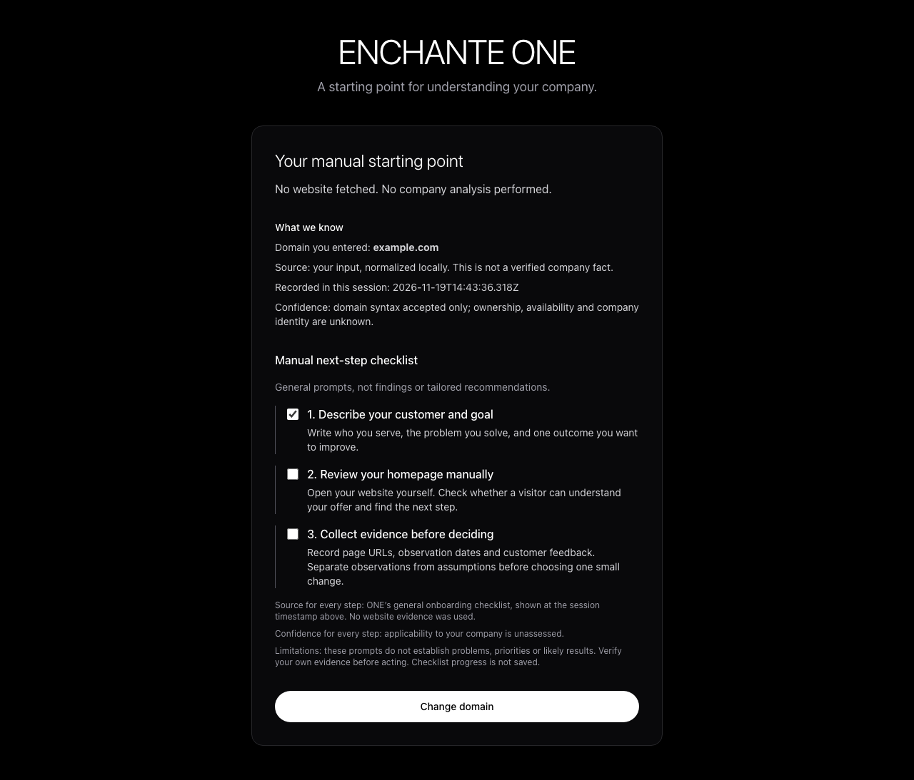
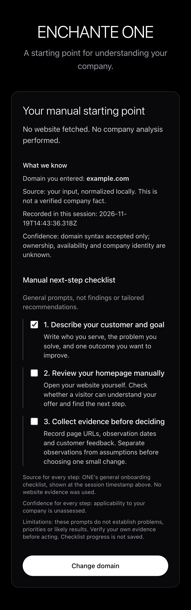

# Pilot evidence — 2026-11-19

## Proven worker cycle

Base: `914d93a07a1d2223feec2d027e054a8b37e148bc`.
Orchestrator 0.15.3 session `enchante-one-1`, Codex CLI 0.170.0 with existing
ChatGPT sign-in. Task started 14:39:09 UTC; worker commit at approximately 14:43:55
UTC: `b8032e0d846f3fa3ffee735735ac54030e8f77c4`, branch
`feat/verified-onboarding-pilot`. Supervisor integration branch:
`feat/orchestration-pilot`. Main and draft PR #3 were not changed.

Worker evidence: locked clean install, lint, typecheck (including type generation),
52 unit tests, production build, two Playwright journeys (desktop Chrome and Pixel 7
Chromium emulation) passed. Browser assertions include empty/invalid submissions,
correction, normalized result, keyboard focus, checkbox/reset, reload, no horizontal
overflow, no page errors and no external requests. This does not prove Safari,
real-device or exhaustive accessibility compliance.

Screenshots are from that worker build and were visually inspected by supervisor:
readable content, no clipping, explicit unavailable disclosure, functional checklist.
The mobile result is long and text-heavy; founder product/design acceptance remains
open. This pilot proves delivery plumbing, not market value or production readiness.

## Review and failures (not hidden)

A reviewer in a separate context found an overbroad reserved-label check rejecting
valid domains. Worker fixed suffix handling and added positive regressions. First
unit run failed on example.com; an earlier browser run also failed before the final
passing run. No root-cause claim is made from test counts alone. See the
retained local session transcript for exact commands; raw transcript is not published.

Supervisor supplied immutable GitHub Action revisions and required checkout without
persisted credentials. Worker also changed typecheck to generate Next route types,
so clean-checkout checking does not depend on a previous build.

Initial independent review ran 50 tests before the final two regression additions;
final revision review is recorded in the PR. It is independent context using Codex,
not a different provider/model and not founder authorization.

PR #3's own three unit tests were separately run and passed. They prove only its
local state transitions, not authenticated approvals or autonomous execution.

## Remaining boundaries

- Local `gh` has no sign-in; the connected GitHub integration is a separate access
  path used for publication. Orchestrator's native authenticated PR/CI observation
  and autonomous task-to-PR publishing are not proven.
- Hermes binary/version is accessible with permitted local execution, but its
  company-provider sign-in and automatic engineering handoff were not exercised.
- Claude Code and Grok Build are not installed/discovered as ready.
- GitHub rulesets returned empty; legacy branch protection inspection returned 403.
  Native approval enforcement remains unverified. No merge/deploy was performed.
- No external paid APIs, credits or subscriptions were purchased. Provider dollar
  cost and human attention were not metered. Worker context usage is not total billed
  token usage and is not reported as such.
- Supervisor interventions: initial bounded assignment, one progress probe, review
  correction + local commit instruction, CI hardening. This is supervised orchestration,
  not zero-intervention autonomous operation.
- First Playwright installation automatically garbage-collected older browser-cache
  revisions. Subsequent instructions set PLAYWRIGHT_SKIP_BROWSER_GC=1; project source
  and user documents were not deleted. Future installs should use that setting.

## Walkthrough

Run the app following README. Submit an empty value to see the associated error;
try a credential-bearing URL or IP alias and see rejection. Submit an HTTP(S) domain
URL: paths are discarded, and the result explicitly states no analysis occurred.
Tick a manual step, change domain and confirm progress resets. Reload clears input.
No domain is fetched and no payment or interest-submission action is implied.

## Supervisor verification and final review

Clean integration worktree at `3ce7ec88e120e0679ef805defa05df7380cddfcf`:
`npm ci`, lint, typecheck, 52 unit tests, production build and 2 browser tests all
completed with exit 0 on Node 24.18.1/macOS. The independent reviewer rechecked this
revision and desktop/mobile screenshots: no blocking findings. CI hardening and
reserved-suffix regressions were confirmed. This later report and screenshots add
no executable changes. Remote CI must be checked separately in the PR.

Install audit reported zero known vulnerabilities at the time, not a security
guarantee. npm warned about ESLint 9 deprecation and install-script policy notices;
no global approval settings were changed.
