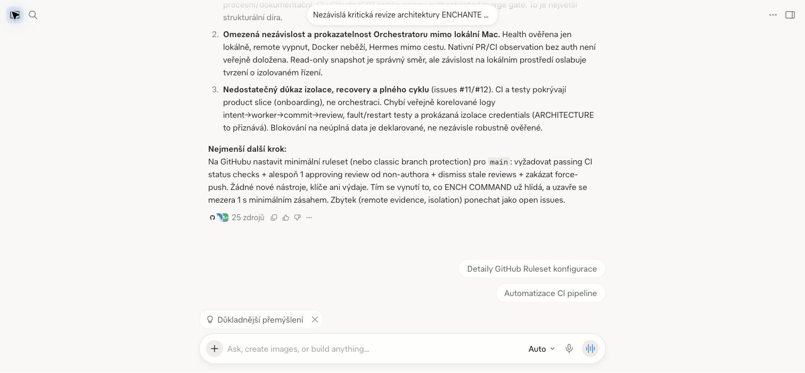

# Grok independent architecture challenge — 2026-11-19

An actual Grok response was obtained through the user's existing authenticated Chrome session, using the visible Auto model selection. No new account, subscription, API key or purchase was used. Exact underlying model/version was not exposed, so it is not asserted. The separate in-app browser was signed out; this did not establish the status of Chrome. Grok CLI remains absent and no automated runtime adapter was demonstrated.

Conversation: https://grok.com/c/733d4829-6f72-4a32-80c4-c1a6dfebd21f

## Supplied scope

A bounded architectural challenge using the public repository/PR #5 and the observed design: GPT protocol, local Orchestrator/Codex, restricted Claude review, read-only COMMAND evidence, draft-only publication, unprotected main, disabled remote host, unavailable Docker and Hermes service mismatch. The prompt requested three gaps, the smallest next step and explicit separation of facts/hypotheses. No credentials, personal data or private source files were sent.

## Observed result (paraphrased)

Grok returned three principal gaps: server-side founder approval enforcement; evidence for execution beyond the local Mac; and isolation/recovery with correlated intent-to-result logs. It recommended requiring CI and a non-author approval on main, stale-review dismissal and force-push protection, leaving isolation/remote questions open.

These recommendations do not close issues #10–#13. Grok did not inspect the new unpublished COMMAND executable revision or run its tests. Its response mixes the supplied current facts with older public pilot evidence. In particular, it cites the older connector 403 protection result and uncertainty about local gh authentication; supervisor's newer authenticated gh probe succeeded and returned 404 Branch not protected. Its cache concern was explicitly speculative: this collector makes actual GET requests and labels its saved result as a snapshot. Treat the challenge as an independent architectural opinion, not a code-review verdict, security certificate or live runtime proof.

## Evidence

Browser UI visibly completed the response; the conversation remains accessible in the existing account. Screenshot below records the recommendations, with unrelated browser sidebar data hidden.

## Verified protection update — 2026-11-19 15:37:26 UTC

The coordinated independent audit task configured protection on main. This supervisor separately re-fetched the authenticated GitHub protection endpoint successfully: required check `verify` pinned to GitHub Actions app 15368, strict/up-to-date checks, enforce_admins=true, one approving review, dismiss_stale_reviews=true, require_last_push_approval=true, required_conversation_resolution=true, force pushes=false and deletions=false. Earlier absence/404 observations and model statements are historical, preceding this change; they are preserved rather than overwritten. This task performed the confirming read, not the configuration change. A rejected unauthorized merge/push experiment and a production environment approval gate are not established by the GET response; issue #10 remains open. No merge or deployment occurred.
